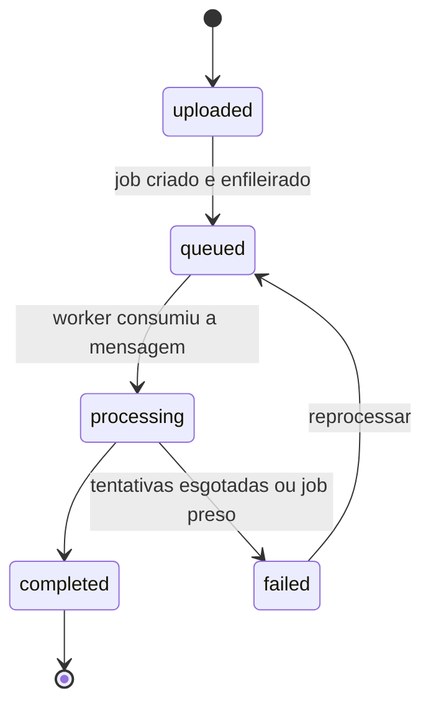
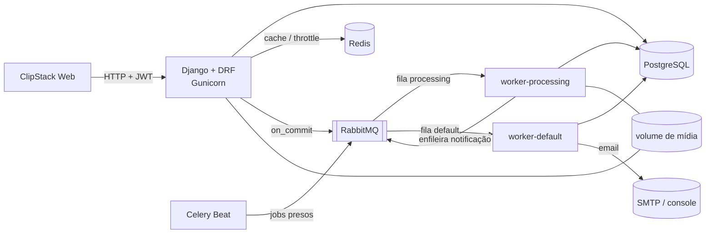
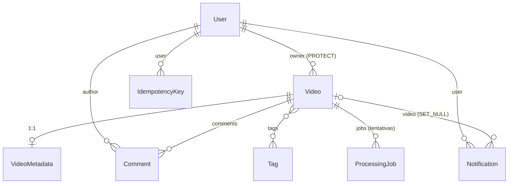

# ClipStack API

API REST de upload e **processamento assíncrono de vídeos**, construída com Django, Django REST
Framework e Celery sobre RabbitMQ.

> Projeto de estudo do uso de **filas de processamento** dentro da estrutura de projeto Django
> mais comum em aplicações comerciais: apps por domínio, camada de services, DRF, JWT, Celery
> com filas separadas, Redis para cache e throttling, tudo containerizado.

O cliente web fica em um repositório separado: **ClipStack Web** (React + Vite).

---

## O que o projeto faz

1. O usuário se cadastra, faz login (JWT) e envia um vídeo.
2. A API salva o arquivo, cria um **job de processamento** e publica uma mensagem na fila
   `processing` do RabbitMQ, só depois de a transação no banco ser confirmada.
3. Um **worker Celery** consome a fila e processa o vídeo: extrai duração e resolução e gera um
   thumbnail (com ffmpeg, quando disponível, ou com um processador simulado), atualizando o
   progresso do job no banco.
4. Falhas temporárias são **retentadas com backoff exponencial**; ao esgotar as tentativas, o job
   vai para `failed` com a mensagem de erro.
5. Ao terminar, uma task na fila `default` cria uma **notificação no app** e envia um **email**
   ao dono do vídeo.
6. Uma tarefa periódica (Celery Beat) marca como `failed` os jobs presos em `processing`.

Ciclo de vida do vídeo:



Além do fluxo principal: comentários nos vídeos, tags, vídeos públicos e privados, busca, filtros
e paginação, painel de estatísticas com cache, e uma área de administração para moderação
(o admin vê e apaga conteúdo, mas não edita o conteúdo de outros usuários).

## Objetivo

Exercitar, num domínio pequeno, os problemas reais de um sistema com filas:

- **Consistência entre banco e fila**: enfileirar só após o commit (`transaction.on_commit`).
- **Idempotência**: a task pode rodar mais de uma vez sem duplicar trabalho; o `POST` de upload
  aceita o header `Idempotency-Key`.
- **Concorrência**: `select_for_update` para impedir dois reprocessamentos simultâneos.
- **Confiabilidade**: `acks_late`, retries com backoff, detecção de jobs presos.
- **Isolamento de carga**: fila pesada (`processing`) e fila leve (`default`) com workers próprios.
- **Organização de código**: regras de negócio em services, leituras complexas em selectors,
  fronteiras entre apps verificadas por import-linter.

## Stack

| Tecnologia | Papel no projeto |
|---|---|
| Python 3.14 · Django 5.2 LTS | Framework web, ORM, migrations, admin |
| Django REST Framework | Serializers, ViewSets, permissões, paginação, throttling |
| PostgreSQL 18 | Banco principal |
| Celery | Workers que processam os vídeos e enviam notificações |
| RabbitMQ | Broker das filas `processing` e `default` |
| Redis | Cache, contadores de throttling e result backend do Celery |
| Celery Beat · Flower | Tarefas periódicas · monitoramento dos workers |
| djangorestframework-simplejwt | Autenticação JWT com refresh, rotação e blacklist |
| django-filter · django-cors-headers | Filtros na listagem · CORS para o frontend |
| drf-spectacular | Documentação OpenAPI / Swagger |
| ffmpeg | Extração de duração e thumbnail |
| pytest · pytest-django · factory_boy | Testes |
| ruff · import-linter | Lint/formatação · fronteiras entre apps |
| Gunicorn · Docker · docker compose | Execução em produção e ambiente local |
| uv | Gerenciamento de dependências e do ambiente virtual |

## Arquitetura



Organização do código (uma app por domínio):

```
config/            settings por ambiente (base, dev, prod, test), urls, api_v1, wsgi/asgi
apps/
  core/            infraestrutura compartilhada: exceções, paginação, permissões, middleware
  accounts/        usuário, cadastro, perfil, administração de usuários
  videos/          vídeos, metadados, tags, comentários
  processing/      jobs de processamento, tasks e processadores de vídeo
  notifications/   notificações no app e emails
```

Cada app segue a mesma divisão:

| Arquivo | Responsabilidade |
|---|---|
| `models.py` | Tabelas, QuerySets customizados, métodos de domínio simples |
| `api/serializers.py` | Validação de entrada e formato de saída (HTTP) |
| `api/views.py` · `api/urls.py` | Endpoints; delegam para services e selectors |
| `services.py` | Casos de uso que escrevem: regras, transações, enfileiramento |
| `selectors.py` | Leituras complexas (filtros, prefetch, agregações) |
| `tasks.py` | Tasks Celery |
| `exceptions.py` | Exceções de domínio, convertidas no formato de erro padrão da API |
| `admin.py` | Django Admin |

Fronteiras entre apps: `videos` não importa `processing` nem `notifications`. As duas podem
importar `videos`, e a comunicação entre apps passa pelos services. Os contratos ficam no
`pyproject.toml` e são verificados com `lint-imports`:

```
core  ←  accounts  ←  videos  ←  processing
                            ↖  notifications
```

### Modelo de dados



Garantias no banco: email e nome de tag únicos, **no máximo um job ativo por vídeo** (índice
único parcial), progresso entre 0 e 100 (check constraint) e `Idempotency-Key` única por
usuário. O vídeo usa soft delete (`is_deleted`), e as tags iniciais são criadas por uma data
migration.

## Endpoints

Todos sob `/api/v1/`. A raiz (`GET /api/v1/`) lista os recursos do router.

| Método e rota | Descrição | Acesso |
|---|---|---|
| `GET /health/` | Banco, Redis e RabbitMQ verificados em paralelo (200 ou 503) | público |
| `GET /meta/` | Status, visibilidades e limites de upload para o frontend | público |
| `POST /auth/register/` | Cadastro | público |
| `POST /auth/login/` | Login por email e senha → `access` + `refresh` (5 tentativas/min) | público |
| `POST /auth/refresh/` | Novo `access` e novo `refresh` (rotação; o antigo é invalidado) | público |
| `POST /auth/logout/` | Invalida o `refresh` (blacklist) | público |
| `GET/PATCH /users/me/` | Perfil do usuário logado | autenticado |
| `GET/POST /videos/` | Lista (visíveis para o usuário) e upload (multipart) | autenticado |
| `GET/PATCH/PUT/DELETE /videos/{id}/` | Detalhe, edição e exclusão (soft delete) | autenticado |
| `POST /videos/{id}/reprocess/` | Reprocessa um vídeo que falhou (202; 409 se não puder) | autenticado |
| `GET/POST /videos/{id}/comments/` | Comentários do vídeo | autenticado |
| `DELETE /videos/{id}/comments/{id}/` | Apagar comentário | autenticado |
| `GET /tags/` · `POST/PUT/PATCH/DELETE /tags/{id}/` | Tags (escrita só admin) | autenticado / admin |
| `GET /jobs/` · `GET /jobs/{id}/` | Jobs de processamento dos próprios vídeos | autenticado |
| `GET /notifications/` · `POST /notifications/mark-all-read/` | Notificações | autenticado |
| `GET /dashboard/stats/` | Vídeos por status, duração total, mais comentados (cache de 5 min no Redis, invalidado a cada mudança) | autenticado |
| `GET /admin/users/` · `POST /admin/users/{id}/set-role/` | Usuários e troca de papel | admin |

**Idempotency-Key:** `POST /videos/` aceita o header `Idempotency-Key`. Repetir a requisição
com a mesma chave devolve a resposta original (com `Idempotent-Replayed: true`) em vez de criar
outro vídeo, inclusive quando as duas chegam ao mesmo tempo.

### Listagem, filtros e paginação

`GET /videos/` aceita filtros combináveis:

| Parâmetro | Exemplo |
|---|---|
| Status, visibilidade, tag | `?status=completed&visibility=public&tag=vlog` |
| Intervalo de datas | `?created_after=2026-01-01&created_before=2026-06-30` |
| Só os meus | `?mine=true` |
| Busca no título | `?search=django` |
| Ordenação | `?ordering=-created_at` ou `?ordering=title` |
| Paginação | `?page=2&page_size=50` (padrão 20, máximo 100) |

As respostas paginadas trazem `count`, `next`, `previous` e `results`. As notificações usam
paginação por **cursor** (`?cursor=...`), estável mesmo com notificações novas chegando.

### Erros

Todo erro sai no mesmo formato:

```json
{"error": {"code": "validation_error", "message": "Os dados enviados são inválidos.",
           "details": {"title": ["Este campo é obrigatório."]}}}
```

| Status | `code` (exemplos) |
|---|---|
| 400 | `validation_error` |
| 401 | `not_authenticated`, `token_not_valid` |
| 403 | `permission_denied` |
| 404 | `not_found` |
| 409 | `video_not_reprocessable`, `processing_already_active`, `cannot_change_own_role` |
| 422 | `idempotency_key_reused` |
| 429 | `throttled` (com `details.wait_seconds` e o header `Retry-After`) |
| 500 | `server_error` |

### Limites, CORS e rastreio

- **Rate limit** (contadores no Redis): 30/min sem login, 120/min por usuário, **10 uploads por
  hora** e **5 tentativas de login por minuto**.
- **CORS**: só a origem do frontend (`CORS_ALLOWED_ORIGINS`) pode chamar a API pelo navegador.
- **X-Request-ID**: toda resposta traz um id (ou propaga o recebido). Os logs saem em JSON, uma
  linha por evento, com `request_id` e `user_id`.

## Autenticação e permissões

JWT no header `Authorization: Bearer <access>` (access de 15 min; refresh de 7 dias com rotação
e blacklist). Sem token: `401` com `WWW-Authenticate: Bearer`.

Dois papéis no campo `role` do usuário: `USER` e `ADMIN`. O `ADMIN` também tem `is_staff` (acesso
ao Django Admin), mantido em sincronia automaticamente. O token traz o `role` como claim só para
a interface; **o backend sempre autoriza pelo papel gravado no banco**.

| Ação | Dono | Outro usuário | Admin |
|---|---|---|---|
| Ver vídeo público e concluído | ✅ | ✅ | ✅ |
| Ver vídeo privado | ✅ | 404 | ✅ |
| Editar vídeo | ✅ | 404 ou 403 | 403 |
| Apagar vídeo | ✅ | 404 ou 403 | ✅ (moderação) |
| Reprocessar vídeo | ✅ | 404 ou 403 | 403 |
| Comentar | em vídeo que pode ver | idem | idem |
| Apagar comentário | autor ✅ | 403 | ✅ (moderação) |
| Tags | leitura | leitura | leitura e escrita |
| Jobs de processamento | dos seus vídeos | — | todos |
| Notificações | só as próprias | só as próprias | só as próprias |
| Listar usuários / mudar papel | ❌ | ❌ | ✅ |

404 quando o recurso não é visível para quem pede (não revela que existe); 403 quando é visível,
mas a ação não é permitida.

### Processar jobs sem fila

Enquanto os workers não estão rodando, um management command processa os jobs na hora:

```bash
uv run python manage.py process_job --queued        # todos os jobs na fila
uv run python manage.py process_job 12 --processor apps.processing.processors.FfmpegVideoProcessor
```

## Como rodar

### Pré-requisitos

- [uv](https://docs.astral.sh/uv/) (instala o Python 3.14 automaticamente)
- Docker e docker compose

### Modo local (infraestrutura no Docker, Django no host)

```bash
cp .env.example .env              # e troque o DJANGO_SECRET_KEY
docker compose up -d --wait       # Postgres, Redis, RabbitMQ, workers do Celery, beat e flower
uv sync                           # cria o .venv e instala as dependências
uv run python manage.py migrate
uv run python manage.py createsuperuser
uv run python manage.py runserver
```

Os workers do Celery rodam no Docker (o pool *prefork* do Celery não funciona no Windows) e
leem os vídeos da pasta `./media`, a mesma em que o Django local grava os uploads. Para subir
só a infraestrutura: `docker compose up -d postgres redis rabbitmq` (e processe os jobs com
`manage.py process_job --queued`).

| Serviço | Endereço |
|---|---|
| API | <http://localhost:8000/api/v1/> |
| Django Admin | <http://localhost:8000/admin/> |
| RabbitMQ (management) | <http://localhost:15672> (clipstack / clipstack) |
| Flower (Celery) | <http://localhost:5555> |

### Filas

| Fila | Worker | Tasks | Por quê |
|---|---|---|---|
| `processing` | `worker-processing` (`-c 2`, prefetch 1) | `process_video` | Pesada (ffmpeg): poucos processos, uma mensagem por vez |
| `default` | `worker-default` (`-c 4`) | notificação, email, tarefas do Beat | Leve e urgente: não espera atrás dos vídeos |

Tasks com `acks_late` (um worker que morre devolve a mensagem à fila) e idempotentes (rodar duas
vezes não duplica nada). Falhas temporárias são retentadas com backoff exponencial e jitter; o
Celery Beat marca como falhos os jobs presos em processamento.

```bash
docker compose logs -f worker-processing worker-default   # acompanhar as tasks e os emails (console)
```

### Qualidade

```bash
uv run ruff check .               # lint
uv run ruff format .              # formatação
uv run lint-imports               # fronteiras entre apps
uv run python manage.py makemigrations --check   # nenhuma migration pendente
uv run pytest                     # testes
```

## Roadmap

- [x] Setup: settings por ambiente, apps por domínio, PostgreSQL no Docker
- [x] Models, relacionamentos, QuerySets, constraints e Django Admin
- [x] Serializers
- [x] Views, URLs e routers
- [x] Services, selectors, exceções de domínio, Idempotency-Key
- [x] Autenticação JWT, papéis e permissões
- [x] CORS, middleware de request id, throttling, paginação, filtros, erros padronizados, logs JSON
- [x] Celery + RabbitMQ (duas filas), retries, Beat, Flower, notificações
- [x] Cache de estatísticas e health check assíncrono
- [ ] Testes automatizados
- [ ] CI, OpenAPI e compose completo com Gunicorn e workers
