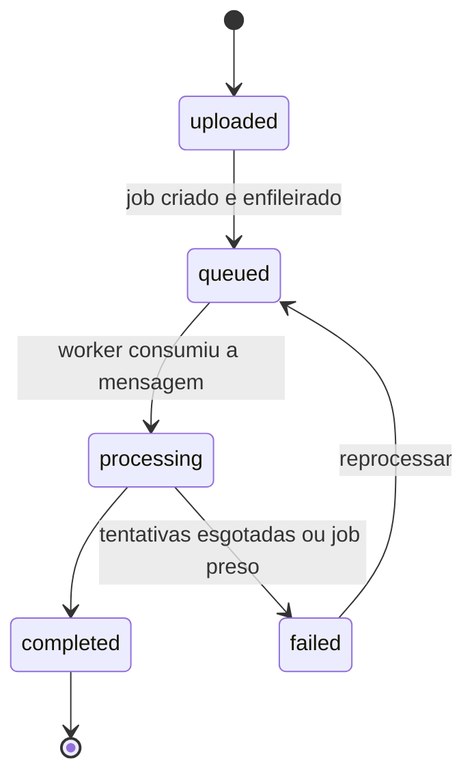
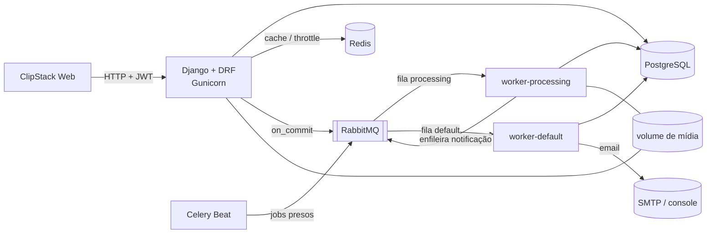
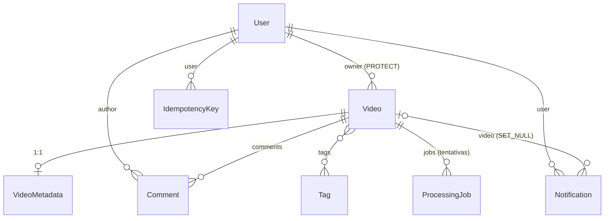

# ClipStack API

API REST de upload e **processamento assíncrono de vídeos**, construída com Django, Django REST
Framework e Celery sobre RabbitMQ.

> Projeto de estudo do uso de **filas de processamento** dentro da estrutura de projeto Django
> mais comum em aplicações comerciais: apps por domínio, camada de services, DRF, JWT, Celery
> com filas separadas, Redis para cache e throttling, tudo containerizado.

O cliente web fica em um repositório separado: **ClipStack Web** (React + Vite).

---

## O que o projeto faz

1. O usuário se cadastra, faz login (JWT) e envia um vídeo.
2. A API salva o arquivo, cria um **job de processamento** e publica uma mensagem na fila
   `processing` do RabbitMQ, só depois de a transação no banco ser confirmada.
3. Um **worker Celery** consome a fila e processa o vídeo: extrai duração e resolução e gera um
   thumbnail (com ffmpeg, quando disponível, ou com um processador simulado), atualizando o
   progresso do job no banco.
4. Falhas temporárias são **retentadas com backoff exponencial**; ao esgotar as tentativas, o job
   vai para `failed` com a mensagem de erro.
5. Ao terminar, uma task na fila `default` cria uma **notificação no app** e envia um **email**
   ao dono do vídeo.
6. Uma tarefa periódica (Celery Beat) marca como `failed` os jobs presos em `processing`.

Ciclo de vida do vídeo:



Além do fluxo principal: comentários nos vídeos, tags, vídeos públicos e privados, busca, filtros
e paginação, painel de estatísticas com cache, e uma área de administração para moderação
(o admin vê e apaga conteúdo, mas não edita o conteúdo de outros usuários).

## Objetivo

Exercitar, num domínio pequeno, os problemas reais de um sistema com filas:

- **Consistência entre banco e fila**: enfileirar só após o commit (`transaction.on_commit`).
- **Idempotência**: a task pode rodar mais de uma vez sem duplicar trabalho; o `POST` de upload
  aceita o header `Idempotency-Key`.
- **Concorrência**: `select_for_update` para impedir dois reprocessamentos simultâneos.
- **Confiabilidade**: `acks_late`, retries com backoff, detecção de jobs presos.
- **Isolamento de carga**: fila pesada (`processing`) e fila leve (`default`) com workers próprios.
- **Organização de código**: regras de negócio em services, leituras complexas em selectors,
  fronteiras entre apps verificadas por import-linter.

## Stack

| Tecnologia | Papel no projeto |
|---|---|
| Python 3.14 · Django 5.2 LTS | Framework web, ORM, migrations, admin |
| Django REST Framework | Serializers, ViewSets, permissões, paginação, throttling |
| PostgreSQL 18 | Banco principal |
| Celery | Workers que processam os vídeos e enviam notificações |
| RabbitMQ | Broker das filas `processing` e `default` |
| Redis | Cache, contadores de throttling e result backend do Celery |
| Celery Beat · Flower | Tarefas periódicas · monitoramento dos workers |
| djangorestframework-simplejwt | Autenticação JWT com refresh, rotação e blacklist |
| django-filter · django-cors-headers | Filtros na listagem · CORS para o frontend |
| drf-spectacular | Documentação OpenAPI / Swagger |
| ffmpeg | Extração de duração e thumbnail |
| pytest · pytest-django · factory_boy | Testes |
| ruff · import-linter | Lint/formatação · fronteiras entre apps |
| Gunicorn · Docker · docker compose | Execução em produção e ambiente local |
| uv | Gerenciamento de dependências e do ambiente virtual |

## Arquitetura



Organização do código (uma app por domínio):

```
config/            settings por ambiente (base, dev, prod, test), urls, api_v1, wsgi/asgi
apps/
  core/            infraestrutura compartilhada: exceções, paginação, permissões, middleware
  accounts/        usuário, cadastro, perfil, administração de usuários
  videos/          vídeos, metadados, tags, comentários
  processing/      jobs de processamento, tasks e processadores de vídeo
  notifications/   notificações no app e emails
```

Cada app segue a mesma divisão:

| Arquivo | Responsabilidade |
|---|---|
| `models.py` | Tabelas, QuerySets customizados, métodos de domínio simples |
| `api/serializers.py` | Validação de entrada e formato de saída (HTTP) |
| `api/views.py` · `api/urls.py` | Endpoints; delegam para services e selectors |
| `services.py` | Casos de uso que escrevem: regras, transações, enfileiramento |
| `selectors.py` | Leituras complexas (filtros, prefetch, agregações) |
| `tasks.py` | Tasks Celery |
| `exceptions.py` | Exceções de domínio, convertidas no formato de erro padrão da API |
| `admin.py` | Django Admin |

Fronteiras entre apps: `videos` não importa `processing` nem `notifications`. As duas podem
importar `videos`, e a comunicação entre apps passa pelos services. Os contratos ficam no
`pyproject.toml` e são verificados com `lint-imports`:

```
core  ←  accounts  ←  videos  ←  processing
                            ↖  notifications
```

### Modelo de dados



Garantias no banco: email e nome de tag únicos, **no máximo um job ativo por vídeo** (índice
único parcial), progresso entre 0 e 100 (check constraint) e `Idempotency-Key` única por
usuário. O vídeo usa soft delete (`is_deleted`), e as tags iniciais são criadas por uma data
migration.

## Como rodar

### Pré-requisitos

- [uv](https://docs.astral.sh/uv/) (instala o Python 3.14 automaticamente)
- Docker e docker compose

### Modo local (infraestrutura no Docker, Django no host)

```bash
cp .env.example .env              # e troque o DJANGO_SECRET_KEY
docker compose up -d --wait       # sobe a infraestrutura
uv sync                           # cria o .venv e instala as dependências
uv run python manage.py migrate
uv run python manage.py createsuperuser
uv run python manage.py runserver
```

- API: <http://localhost:8000/api/v1/>
- Django Admin: <http://localhost:8000/admin/>

### Qualidade

```bash
uv run ruff check .               # lint
uv run ruff format .              # formatação
uv run lint-imports               # fronteiras entre apps
uv run python manage.py makemigrations --check   # nenhuma migration pendente
uv run pytest                     # testes
```

## Roadmap

- [x] Setup: settings por ambiente, apps por domínio, PostgreSQL no Docker
- [x] Models, relacionamentos, QuerySets, constraints e Django Admin
- [ ] Serializers
- [ ] Views, URLs e routers
- [ ] Services, selectors, exceções de domínio, Idempotency-Key
- [ ] Autenticação JWT, papéis e permissões
- [ ] CORS, middleware de request id, throttling, paginação, filtros, erros padronizados, logs JSON
- [ ] Celery + RabbitMQ (duas filas), retries, Beat, Flower, notificações
- [ ] Cache de estatísticas e health check assíncrono
- [ ] Testes automatizados
- [ ] CI, OpenAPI e compose completo com Gunicorn e workers
